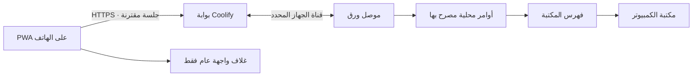

# خطة تطوير واجهة هاتف ورق: PWA وقوائم مضغوطة ومكتبة ملفات

التاريخ: 16 أكتوبر 2026. الحالة: نُفذت PWA والواجهة المضغوطة والمكتبة في المصدر، واجتازت الاختبارات المحلية الآلية واختبار HTTPS المتكامل بجهازي ورق. يشترط نشر إصدار GitHub نجاح فحوص Windows وDocker/PostgreSQL. ينشر المستخدم التحديث على VPS بنفسه. لا تعني هذه الوثيقة اعتماد تثبيت Android/iOS على هواتف فعلية.

## سجل التنفيذ والتحقق

- أضيفت صفوف مختصرة للطابور والعمال والمصدر ونتائج المهام، مع عنوان وحالة وإجراء أساسي و«المزيد». اجتازت واجهة Edge عروض 320–768 والوضع الأفقي والمظهرين وتكبير النص 200% دون تمرير أفقي.
- أضيف قسم «المكتبة» مستقلًا عن «نتائج المهام»، مع بحث وتصفية ومجموعات وصفحات 50 ملفًا، ومعاينة نص آمنة وتنزيل وحذف مؤكد وتنظيم. فهرس محلي دائم بمعرّفات معتمة ومراجعات؛ اختُبرت أكثر من 3000 نتيجة وحماية النسخ الأصلية ورفض الجَنكشن والملف المتغير.
- اجتاز اختبار HTTPS الفعلي بجهازي Qt مسار الاقتران الخارجي والرفع والتنزيل والمعاينة وترقيم المكتبة والحذف مع بقاء الأصل، وعزل الجهازين وإلغاء الاقتران أثناء فتح المعاينة ومسح بياناتها من الشاشة. عميل Windows قديم يظل قادرًا على العمليات السابقة وتظهر له رسالة تحديث للمكتبة.

- أضيف Manifest ثابت الهوية، وأيقونات PNG عادية وMaskable وأيقونة Apple مشتقة من SVG الأصلي، وغلاف انقطاع، وService Worker بقائمة تخزين عامة صريحة فقط.
- تُفعّل تحسينات PWA على صفحات الإنترنت عبر HTTPS فقط. تبقى صفحات HTTP/LAN دون Manifest أو زر تثبيت أو تسجيل Service Worker.
- أضيف تثبيت Android عند توفر حدث المتصفح وإرشادات Safari على iPhone، واقتران داخل الصفحة بالكاميرا أو لصق رابط الأصل نفسه. بديل قراءة QR هو jsQR 1.4.0 محلي بترخيص Apache-2.0، دون CDN وقت التشغيل.
- تحديث الواجهة ينتظر طلب المستخدم وخمول جميع النوافذ. تُقفل بدايات العمليات أثناء التنسيق، وتبقى النسخة السابقة إذا فشل تنزيل أصل. لا تُعاد الأوامر عند العودة للشبكة أو تحديث الغلاف.
- يختبر `tests/verify_pwa.py` عبر HTTPS وعامل خدمة حقيقي في Edge: قائمة Cache Storage، غلاف الإنترنت دون شبكة، بقاء API والتنزيلات شبكة فقط، حفظ استجابة HTTP 403، التثبيت عند توفر الحدث، لصق رابط خارجي مرفوض، فك QR حقيقي بواسطة البديل المحلي، تنظيف مسارات كاميرا محاكاة بما فيها الإغلاق المتأخر وpagehide، فشل تثبيت تحديث، وتحديث نافذتين مع نافذة مشغولة. كما يفحص إرشادات iPhone بمحاكاة user agent وخمول تحسينات PWA على HTTP.
- أضيف الفحص إلى بوابتي CI وRelease. نجاح اختبار متصفح محلي أو سير عمل مستقبلي لا يثبت نشر VPS. تثبيت حقيقي وكاميرا فعلية على Android/Chrome وiPhone/Safari، وجلسة التطبيق المثبت بعد التثبيت، وتجربة بيانات الجوال ما تزال فحوصًا فعلية لازمة عند توفر الأجهزة.
- ترتيب الترقية: بوابة الدومين أولًا، ثم Windows الداعم للمكتبة؛ تبقى جلسة الهاتف المقترن داخل السياق نفسه دون إعادة تسجيل بسبب التحديث. إذا فتح المستخدم PWA بسياق تخزين منفصل لا ينتقل الاقتران تلقائيًا ولا يُصلح بمنح خفية؛ يُلغى الاقتران القديم صراحةً من الكمبيوتر ثم يُنشأ QR جديد داخل PWA.

## 1. النتيجة المطلوبة

واجهة عربية يمكن تثبيتها على الهاتف من الدومين `https://waraqstudio.jadallah.work`، بصفوف مختصرة بدل البطاقات الطويلة، وصفحة ملفات تصل إلى مكتبة الكمبيوتر نفسه. يبقى التنفيذ على الكمبيوتر وتبقى هوية كل جهاز وصلاحية الهاتف المقترن به مستقلة. الهاتف المقترن سابقًا يحتفظ بوصوله بعد التحديث ما دامت جلسته صالحة.

النطاق الأساسي يشمل Android وiPhone، والمتصفح العادي والتطبيق المثبّت، والوضعين الفاتح والداكن. تبقى واجهة Wi-Fi صالحة للاستعمال في المتصفح؛ التثبيت الكامل يستهدف عنوان HTTPS العام.

## 2. ما كشفته مراجعة الكود

| الوضع الحالي | أثره في التنفيذ |
|---|---|
| `waraq/mobile/` يحتوي HTML وCSS وJavaScript مشتركة بين LAN والبوابة | تطوير الواجهة الحالية دون نقلها إلى إطار عمل آخر أو فصل نسختين متعارضتين |
| لا يوجد Manifest أو Service Worker حاليًا | إضافة أصول PWA ومسارات خدمتها وسياسة تحديث وتخزين محددة |
| `renderFiles()` يستخرج النتائج من `ui.state.jobs` | تبويب النتائج لا يمثل مكتبة الديسكتوب، ولا يحتفظ بإظهار ملف بعد حذف سجل مهمته |
| `Library.scan()` يقرأ المكتبة ويعرض Word/TXT/الصوت ومجموعاتها؛ حده الافتراضي 3000 ملف | بناء قراءة ملفات مستقلة ومقسّمة إلى صفحات، وعدم إعلان تعداد كامل انطلاقًا من نتيجة مقصوصة |
| بيانات مكتبة الديسكتوب تتضمن مسارات Windows مطلقة | يلزم نموذج بيانات خاص للهاتف ومعرّفات ملفات معتمة بدل إرسال هذه المسارات |
| أوامر الهاتف الحالية تسمح بتنزيل Word/TXT من مجلد المهمة فقط | يلزم توسيع مدروس للأوامر والمسارات في الموصل والبوابة وLAN، وليس تعديل CSS فقط |
| حد النقل الحالي 100 MiB للتنزيل و60 ثانية للملف | إظهار الحد بوضوح، ورفض النقل الزائد دون إسقاط اتصال الجهاز |
| حماية CSP الحالية تسمح بأصول محددة، ومسارات الأصول لها قائمة سماح | إضافة `manifest-src` و`worker-src` ومسارات PWA وأنواع MIME الصحيحة، مع إبقاء حماية API |
| `deploy/package_relay.py` يضم ثلاثة ملفات واجهة بأسمائها | توسيع قائمة الحزمة للأيقونات وManifest وService Worker وأي مكتبة QR مرخّصة |
| الكمبيوتر يبدأ اتصال الإنترنت بطلب المستخدم | PWA لا يغيّر هذا السلوك؛ يُستخدم زر الاتصال الجديد في ورق عند فتحه |

## 3. القرارات الأساسية

1. **تطوير تدريجي للواجهة الحالية:** إعادة تنظيم JavaScript إلى وحدات صغيرة عند الحاجة، مع الحفاظ على تشغيلها دون CDN أو أدوات بناء إضافية غير ضرورية.
2. **أربعة تبويبات رئيسية:** العمليات، إضافة مصدر، العمال، الملفات. يتحول تبويب النتائج الحالي إلى «الملفات»، وداخله «المكتبة» و«نتائج المهام» حتى تبقى النتائج التي لم تنظّم بعد متاحة.
3. **جهاز واحد نشط لكل شاشة:** اسم الكمبيوتر وحالته ظاهران؛ تغيير الجهاز ينشئ شاشة جديدة ويمسح بيانات الجهاز السابق وطلباته المؤقتة.
4. **صف أساسي واحد لكل عنصر:** العنوان والحالة والإجراء الأساسي وزر «المزيد» على الصف نفسه. تظهر المعلومات والأوامر الإضافية في لوحة تفاصيل عند الطلب.
5. **PWA يخزن غلاف الواجهة العام فقط:** لا يحفظ قوائم المهام أو المكتبة أو الملفات أو الاعتمادات في Cache Storage أو IndexedDB.
6. **لا أوامر مؤجلة دون اتصال:** يتوقف الإرسال عند غياب الجهاز أو الشبكة؛ لا تضاف Background Sync لطابور الأوامر.
7. **صفحة الملفات تمثل المكتبة الحقيقية:** تعرض النسخ المحفوظة في مكتبة الكمبيوتر، بما فيها التي حُذف سجل مهمتها، ضمن الأنواع والبنية المعتمدة.
8. **التوافق قبل التوسع:** إذا لم يدعم الديسكتوب الجديد واجهات المكتبة، تعمل الوظائف الحالية ويظهر طلب تحديث واضح بدل أخطاء متكررة.

## 4. تجربة PWA

### 4.1 التثبيت والهوية

- Manifest باسم ورق وأيقونات PNG عادية وMaskable بأحجام مناسبة، وأيقونة Apple Touch، واتجاه عربي RTL ولون بدء يناسب التطبيق.
- `id` ثابت و`start_url: /internet` و`scope: /` و`display: standalone`. لا يُربط Manifest بتذكرة QR أو معرّف كمبيوتر أو جلسة مستخدم.
- على Android يظهر زر تثبيت عند توفر حدث التثبيت؛ عند عدم توفره تعرض إرشادات مناسبة للمتصفح. على iPhone تعرض خطوات الإضافة للشاشة الرئيسية ولا يظهر زر يوهم بتوفر حوار تثبيت غير مدعوم.
- يستقبل فتح الأيقونة المستخدم في قائمة أجهزته المصرح بها، ثم يختار الجهاز. يمكن تذكر آخر معرّف مختار كتفضيل غير سري، لكن يعاد التحقق من صلاحيته قبل عرض أي بيانات أو إرسال أمر.
- تثبيت PWA يكون من HTTPS. خادم Wi-Fi الحالي يعمل بـHTTP على عنوان خاص، ولذلك يعرض واجهة المتصفح دون وعد بتثبيت كامل أو تسجيل Service Worker غير مدعوم. [MDN: السياقات الآمنة](https://developer.mozilla.org/en-US/docs/Web/Security/Defenses/Secure_Contexts)، [دليل تثبيت PWA](https://web.dev/learn/pwa/installation).

### 4.2 الاقتران داخل التطبيق المثبّت

هذه نقطة إلزامية قبل اعتماد PWA، بسبب اختلاف تخزين جلسات المتصفح والتطبيق المثبّت بين المنصات والإصدارات. WebKit يوضح أن بعض الإصدارات تنسخ Cookies عند التثبيت، ثم لا تشارك بقية بيانات الموقع باستمرار. لن نعتمد على انتقال الجلسة تلقائيًا. [WebKit Safari 17.2](https://webkit.org/blog/14787/webkit-features-in-safari-17-2/).

المسار المضمون:

1. يثبت المستخدم ورق ويفتحه من الأيقونة.
2. يختار «ربط كمبيوتر» من داخل PWA.
3. يقرأ QR بالكاميرا داخل PWA، أو يلصق رابط الاقتران الكامل كبديل.
4. يستعمل التدفق الحالي: تذكرة أحادية الاستخدام، اسم الهاتف، رمز المطابقة، وموافقة الكمبيوتر.
5. تُنشأ الجلسة في سياق التطبيق المثبّت نفسه، دون زيادة صلاحياته أو تجاوز قيد الهاتف الواحد.

تفاصيل التنفيذ:

- كاشف QR أصلي عند دعمه، وبديل محلي مرخّص عند غيابه؛ لا يعتمد التشغيل على `BarcodeDetector` وحده لأن دعمه محدود. [مرجع MDN](https://developer.mozilla.org/en-US/docs/Web/API/BarcodeDetector).
- طلب إذن الكاميرا بعد ضغط المستخدم فقط، وإيقاف مسارات الكاميرا فور القراءة أو إغلاق الشاشة.
- بديل لصق الرابط يعمل دائمًا إذا رُفضت الكاميرا. يُقبل أصل البوابة الحالي والمسار المتوقع فقط؛ لا تنفذ إعادة توجيه إلى عنوان مستخرج عشوائيًا من QR.
- تزال التذكرة من العنوان وحقل الإدخال والذاكرة بعد استخدامها؛ لا تحفظ في تفضيلات الجهاز أو السجلات أو الكاش.
- الهاتف المقترن سابقًا من متصفح مستقل: إن لم تنتقل الجلسة، يوضح التطبيق إلغاء الاقتران القديم من الكمبيوتر ثم الاقتران داخل PWA. لا يستبدل الهاتف تلقائيًا ولا يغير شرط الهاتف الواحد.
- يبقى فتح QR بالطريقة الحالية في المتصفح مدعومًا، مع اختبار عدم عودة خطأ التنقل الخارجي السابق.

### 4.3 التخزين والعمل عند الانقطاع

| المورد | السياسة |
|---|---|
| HTML العام وCSS وJS والأيقونات وواجهة الانقطاع | قائمة تخزين صريحة، بإصدار معروف وأصول من الأصل نفسه |
| `/api/**` وحالة الأجهزة والمهام والمكتبة | طلب شبكة فقط؛ لا تدخل Cache API ولا تعاد من نسخة قديمة |
| تنزيل الملفات والمعاينات | شبكة مصادقة فقط؛ لا يحفظها Service Worker |
| أوامر POST والاقتران والخروج والحذف | لا تخزن ولا تعاد تلقائيًا |
| تذكرة QR أو بيانات المستخدم | لا تدخل مفاتيح الكاش ولا السجلات |

- عند انقطاع الشبكة يظهر غلاف ورق ورسالة واضحة. لا تظهر قائمة خاصة قديمة على أنها حالة حالية.
- لا يستخدم Service Worker صفحة HTML بديلًا لاستجابة API أو ملف أو رفض 401/403؛ fallback مقتصر على تنقلات صفحات الواجهة العامة عند فشل الشبكة فعلًا.
- يُخزن غلاف واحد عام، لا نسخة باسم كل `device_id` أو تذكرة. تبقى سياسة Host/Origin وقيود التنقل إلى صفحات عامة قائمة.
- العودة إلى المقدمة أو الشبكة تبدأ تحققًا جديدًا من الجلسة والجهاز، ثم قراءة البيانات؛ حالة `navigator.onLine` وحدها ليست إثباتًا أن الكمبيوتر متصل.
- تنزيل يختاره المستخدم يحفظه نظام الهاتف وفق المتصفح؛ هذا منفصل عن التخزين التلقائي للواجهة.

### 4.4 تحديث PWA

- إصدار واضح لأصول الواجهة والكاش؛ تفحص الواجهة وجود تحديث دون كسر الجلسة الحالية.
- إشعار «تحديث الواجهة» عند جاهزية نسخة جديدة. لا إعادة تحميل إجبارية أثناء رفع ملف أو تأكيد حذف أو انتظار نتيجة أمر.
- تنسيق تحديث النوافذ المفتوحة أو انتظار خمولها قبل تفعيل العامل الجديد؛ لا `skipWaiting` غير مشروط.
- تنظيف الكاش القديم عند التفعيل بعد نجاح الجديد. يبقى الغلاف القديم صالحًا إذا فشل تنزيل النسخة الجديدة.
- الخروج أو انتهاء الجلسة أو إلغاء الاقتران يمسح القوائم والمعاينات وروابط Blob من الذاكرة فورًا.
- حذف أو عودة الموقع بإصدار سابق يُختبران مع دورة Service Worker، لا مع صفحة دون كاش فقط. [MDN: دورة Service Worker](https://developer.mozilla.org/en-US/docs/Web/API/Service_Worker_API/Using_Service_Workers).

## 5. تصميم القوائم المضغوطة

### الهيكل العام

- شريط علوي صغير يحمل اسم الكمبيوتر وحالة الاتصال وخيار تغيير الجهاز؛ لا يكرر بطاقة كبيرة في كل صفحة.
- أرقام الطابور في شريط مختصر، وأزرار البحث والتصفية في مساحة صغيرة قابلة للطي.
- تنقل سفلي ثابت بأربعة تبويبات، يحترم safe-area ولا يغطي آخر صف أو لوحة المفاتيح.
- الصف الافتراضي نحو 56–64 CSS px، وأهداف اللمس 44×44 على الأقل، ومسافات مناسبة بين الأزرار. عند تكبير النص يسمح بارتفاع أكبر دون إخفاء الإجراءات أو فرض تمرير أفقي.
- عنوان بسطر واحد مع اختصار بصري؛ الاسم الكامل متاح في التفاصيل ولقارئ الشاشة. لا تعالج الأسماء الطويلة بتصغير الخط إلى حجم غير مقروء.
- تستعمل الأزرار ذات الرموز أسماء وصول واضحة، والحالات نصوصًا مع ألوان وليست لونًا وحده.

| القائمة | ما يظهر في الصف | التفاصيل عند الطلب |
|---|---|---|
| المهام | العنوان، الحالة/التقدم، عرض، المزيد | المراحل والأخطاء ووقت الإعادة، إعادة المحاولة/الإلغاء والتنزيل |
| العمال | الاسم، الحالة/المهمة الحالية، الإجراء المتاح | المزود والنموذج والخطأ والوقت؛ إعدادات إضافية حسب الواجهات المصرح بها |
| الخدمات | اسم الخدمة، الحالة، إيقاف/استئناف | سبب التوقف الآلي وعمال الخدمة |
| عناصر YouTube | تحديد، العنوان، حالة الإتاحة | البيانات الثانوية؛ يبقى التحديد والترتيب والإضافة صحيحًا |
| الملفات | النوع، الاسم، الحجم، تنزيل، المزيد | المجموعة والتاريخ والاسم الكامل والمعاينة والحذف المؤكد |
| الأجهزة | الاسم، متصل/غير متصل، فتح | آخر ظهور وخيارات الاقتران المتاحة |

الأوامر النادرة أو المتعددة توضع في «المزيد» بدل حشر عدة أزرار صغيرة. النقر على صف أو العنوان يفتح التفاصيل؛ النقر على زر داخله لا يشغّل إجراء الصف بالخطأ. الإلغاء وإعادة الطلب المدفوع يبقيان بتأكيداتهما.

تحفظ الواجهة البحث والتصفية والتمرير والعنصر المحدد أثناء تحديث الحالة، وتحدث الصفوف بمعرّفاتها بدل إعادة بناء القائمة. لا يعاد مسح المكتبة عند كل نبضة تحديث للطابور.

## 6. صفحة الملفات: مطابقة مفيدة للديسكتوب

### 6.1 المحتوى والأوامر

| وظيفة الديسكتوب | مقابلها على الهاتف في النطاق الأساسي |
|---|---|
| عرض مكتبة الملفات | قراءة المكتبة الفعلية بما فيها الملفات المستقلة عن سجل الطابور |
| Word / التفريغات / الصوت / الكل | الفلاتر نفسها |
| التصفية بمجلد المادة والبحث بالاسم | الفلاتر نفسها، مع «غير مصنف» والمجموعات الموجودة فعليًا |
| الاسم والحجم والتاريخ | صف مختصر وتفاصيل كاملة عند الطلب |
| تحديث القائمة | تحديث صريح مع مؤشر تقدم وخطأ قابل للمحاولة |
| تنظيم الآن | أمر خلفي يعيد استخدام منطق المكتبة ولا يضيف عامل معالجة آخر |
| فتح ملف | معاينة TXT محدودة الحجم، وتنزيل Word/الصوت لفتحه بتطبيق مناسب على الهاتف |
| حذف من المكتبة | حذف مؤكد للنسخة الموجودة في المكتبة وحدها، مع بقاء أصل المهمة |
| نسخ المسار | نسخ اسم الملف أو رابطه الموثق، دون كشف مسار Windows المطلق |
| فتح مجلد الكمبيوتر أو ملف عشوائي من القرص | تنقل داخل مجموعات المكتبة فقط؛ لا يضاف متصفح عام للقرص |

الصوت يظهر ضمن المكتبة إذا كانت نسخة صوت موجودة فيها؛ إعداد نسخ الصوت الحالي في الديسكتوب يظل نافذًا. عدم وجود نسخة في المكتبة لا يُعرض كعطل في الهاتف.

### 6.2 الفصل عن نتائج المهام

داخل تبويب الملفات:

- **المكتبة:** الملفات المنظمة ونسخ المكتبة، وتستمر بعد حذف سجل المهمة.
- **نتائج المهام:** المخرجات الحالية من الطابور، بما فيها النتائج الحديثة التي لم تنظم بعد.

الحذف في المكتبة لا يحذف نتيجة المهمة أو سجلها. لا يقدم قسم نتائج المهام حذف أصل الملفات ضمن هذا الإصدار. يذكر تأكيد الحذف اسم الكمبيوتر والملف حتى لا يختلط الجهاز الحالي بغيره.

### 6.3 القائمة والفهرسة

- فصل قراءة المكتبة عن لقطة الحالة العامة. استدعاؤها عند فتح التبويب أو التحديث أو تغيير البحث والفلاتر.
- فهرس محلي على الكمبيوتر، خارج الخادم، مع صفحات افتراضية 50 ملفًا وحد أعلى 100 لكل طلب. تبقى الاستجابة محدودة حتى مع أكثر من 3000 ملف.
- مسح الملفات والبيانات الوصفية خارج خيط Qt الرئيسي، ونشر النتائج بإشارات آمنة. تستخدم اتصالات قاعدة مناسبة للخيط، ولا يمرر اتصال GUI إلى خيط آخر بلا ضبط.
- معرّف ملف معتم يخص هذا الكمبيوتر، ونسخة/مراجعة للعنصر. لا يعاد استخدام معرف محذوف لملف جديد يحمل الاسم نفسه.
- الفرز والتصفية والتعداد من الفهرس، مع cursor ومراجعة snapshot حتى لا يحدث تكرار أو فقد عند تغير المكتبة بين صفحتين.
- كشف تغير جذر المكتبة أو إعادة الفهرسة يبطل معرّفات الجذر القديم؛ تحديث مسار المكتبة لا يحول معرّفًا سابقًا إلى ملف مختلف.
- JSON للهاتف: `file_id`, `name`, `kind`, `group_id`, `group_name`, `size`, `modified`, `version`, `can_download`, `can_preview`, `can_delete` فقط، مع تعداد وحالة الفهرسة.

### 6.4 الأوامر والملفات

الأسماء التالية مقترح عقد التنفيذ النهائي، وليست API منشورة حاليًا:

| المسار في وضع الإنترنت | الغرض |
|---|---|
| `GET /api/devices/{device_id}/library/files` | قائمة مقسمة مع البحث والنوع والمجموعة وcursor |
| `GET /api/devices/{device_id}/library/files/{file_id}/download` | تنزيل مصادق عليه من المكتبة |
| `GET /api/devices/{device_id}/library/files/{file_id}/preview` | نص محدود الحجم للمعاينة، دون HTML |
| `POST /api/devices/{device_id}/action/library_delete` | حذف مع `file_id` و`expected_version` وتأكيد صريح |
| `POST /api/devices/{device_id}/action/library_organize` | تنظيم خلفي ومنع التشغيل المتكرر المتزامن |

تضاف مسارات LAN المكافئة تحت `/api/library/...`، وتستخدمان منفذ الأوامر المشترك بعد المصادقة. تفصل أوامر القراءة عن الأوامر المعدّلة في سجل منع التكرار؛ لا يسجل كل استعراض باعتباره عملية حذف/تغيير.

### 6.5 ضمانات الوصول والحذف

- إعادة التحقق من اقتران الهاتف بالكمبيوتر لكل قائمة وتنزيل ومعاينة وحذف وتنظيم، بما فيها الطلبات المعلقة.
- حل `file_id` على الكمبيوتر المقصود فقط. محاولة استعمال معرّف A على B تفشل، ولو تصادفت الأسماء.
- لا يقبل endpoint مسارًا أو اسم مجلد حرًا للوصول إلى القرص. التحقق من المسار عند فتح الملف الفعلي، مع رفض traversal والروابط الرمزية وWindows junction/reparse التي تتجاوز الجذر المسموح.
- قبل الحذف يعاد فحص هوية الملف ومراجعته تحت قفل المكتبة؛ إذا تغيّر الملف منذ عرضه يرجع 409 ويطلب التحديث بدل حذف ملف بديل.
- حماية النسخ الجاري نشرها والملفات `.part`، والتنسيق مع تنظيم المكتبة ونسخ نتائج العمال. ضمان أن الحذف لا يمس ملفات المهمة الأصلية أو نسخة جديدة نشرت لاحقًا.
- عند فقد نتيجة الحذف لا يعاد الأمر تلقائيًا؛ يحدث استعلام حالة أولًا، مع استعمال سجل الأوامر الحالي لمنع تكرار التنفيذ.
- إلغاء الاقتران يقطع النقل المعلق. مسح البيانات وتبديل الجهاز يمنعان تطبيق رد متأخر على الجهاز الجديد.

### 6.6 الحدود والمعاينة

- تنزيل دفعات باستخدام النقل الموجود، وحد 100 MiB الحالي. يظهر الملف الأكبر في القائمة مع سبب عدم توفر تنزيله؛ لا يختفي من المكتبة.
- TXT: معاينة أول جزء محدود، مقترح 1 MiB، مع إظهار أن النص مقصوص وإتاحة تنزيل الأصل. دعم UTF-8/BOM وعرض آمن بـ`textContent` دون تفسير HTML.
- Word: تنزيل الملف؛ لا يعتمد الإصدار الأول على محول DOCX/HTML قد يغير تنسيقه أو يضيف سطح هجوم غير ضروري.
- الصوت: تنزيل في الإصدار الأول. التشغيل المتدفق داخل PWA مؤجل حتى اعتماد Range/seek والمهل والإلغاء واستهلاك الذاكرة، ولا يقدم تشغيل وهمي يحمل الملف كاملًا دون بيان.

## 7. البنية وتوزيع التغييرات

| الملفات/المكونات | التغيير المخطط |
|---|---|
| `waraq/mobile/index.html`, `style.css`, `app.js` | صفوف مضغوطة، تفاصيل، تبويب الملفات، التثبيت والتحديث والانقطاع |
| أصول PWA جديدة داخل `waraq/mobile/` | Manifest وService Worker وغلاف انقطاع وأيقونات وQR fallback عند الحاجة |
| وحدة ملفات بعيدة جديدة | فهرسة محلية، معرّفات ومراجعات، DTO محدود وحل وتنزيل/حذف آمن |
| `waraq/library.py` وBridge عند الحاجة | إعادة استخدام التنظيم والحذف مع فحوص التزامن ودون حوارات نظام من طلب الهاتف |
| `waraq/remote_commands.py` | أوامر قراءة المكتبة وتنظيمها وحذف نسخها ومعاينتها |
| `waraq/internet.py` | أوامر وقدرات جديدة، فصل القراءة عن التعديل، نقل مكتبة مقيد |
| `relay/app.py` | مسارات المكتبة، أصول PWA وMIME/CSP/Cache-Control؛ الحفاظ على نطاق الجهاز |
| `waraq/remote.py` | دعم المسارات والقدرات الجديدة في LAN مع نفس ضوابطه |
| Dockerfile والبناء والحزم | التحقق من تضمين كل أصل PWA وملف الترخيص، وتطابق النسخة المنشورة |
| اختبارات الوحدة وQt والمتصفح والحاويات | اختبارات PWA والمكتبة والتحديث والتوافق والعزل |

لا يلزم فصل مستودع جديد أو قاعدة ملفات على VPS. PostgreSQL تبقى للهويات والصلاحيات؛ بيانات المكتبة ومحتواها تبقى على الكمبيوتر.

## 8. التوافق وترتيب النشر

- يعلن الكمبيوتر قدرات إضافية بشكل اختياري دون كسر البروتوكول الحالي، مثل المكتبة والمعاينة والحذف. العميل القديم لا يُعامل كأنه يدعمها.
- تنشر البوابة المتوافقة أولًا. مع ديسكتوب قديم تستمر العمليات الحالية ونتائج المهام، وتظهر دعوة لتحديث الكمبيوتر لفتح المكتبة.
- يصدر Windows الداعم بعد نجاح الاختبارات. لا حاجة لإعادة تسجيل الكمبيوتر أو QR بسبب التحديث وحده.
- تنشأ Service Worker والأصول بإصدارات متناسقة، وتختبر نافذة قديمة مع خادم جديد والعكس، بما فيها خطة الرجوع.
- يطابق إصدار GitHub المصدر وحزمة البوابة وبصماتها. يدير Coolify النشر حسب الإعداد الحالي، وتبقى خطوة اعتماد اختبار VPS والهاتف الفعلي منفصلة عن نجاح CI.

## 9. مراحل التنفيذ وبوابات القبول

| المرحلة | العمل | ما يجب نجاحه قبل الانتقال |
|---|---|---|
| 1. تثبيت العقد والتجربة | مراجعة الصفوف، خريطة تنقل، عقد المكتبة والقدرات وسياسة PWA | تعريف النطاق والحدود والعمليات المدمرة والتوافق في وثيقة اختبار قابلة للتنفيذ |
| 2. أساس الملفات المحلي | فهرسة وصفحات ومعرّفات ومراجعات وحذف وتنظيم | ملفات بعد حذف سجل المهمة، أكثر من 3000 ملف، جذور مختلفة، تزامن ونطاق مسارات |
| 3. نقل الملفات والمصادقة | توصيل الأوامر في الموصل والبوابة وLAN | A/B، إلغاء الجلسة والنقل، deadlines وdedup، عميل قديم دون أخطاء |
| 4. الواجهة المضغوطة | صفوف وتفاصيل وتصفية وتنقل وصفحة الملفات | تفاعل RTL، حفظ التمرير، لمس ولوحة مفاتيح، عدم تداخل الأزرار أو الالتفاف غير المطلوب |
| 5. PWA والاقتران الداخلي | Manifest وSW وأيقونات وتثبيت وكاميرا/لصق وتحديث | تثبيت وبدء من الأيقونة، جلسة داخل PWA، انقطاع، رفض كاميرا، تحديث دون تكرار أوامر |
| 6. التحقق المتكامل | متصفحات وQt وحاويات وجهازان واختبارات نشر | كل معايير القسم التالي، مع تسجيل ما اختبر على هاتف حقيقي وما حوكي فقط |
| 7. الإصدار والنشر | Windows وحزمة البوابة وأدلة الاستخدام وترقية متدرجة | مصدر وبصمات متطابقة، نشر Coolify، تجربة بيانات جوال وإمكان الرجوع |

يمكن تجهيز التصميم واختبارات PWA بالتوازي مع أساس المكتبة عند تنفيذ الخطة بوكلاء، مع ملكية ملفات منفصلة ومراجعة مركزية لعقد الأوامر. لا يبدأ نشر وظائف مكتبة ناقصة لأن تصميم الواجهة سبق تنفيذها.

## 10. الاختبارات المطلوبة

### PWA والأمان

- Manifest صحيح، أيقونات قابلة للتحميل، `id/start_url/scope` ثابتة، تسجيل SW وMIME وCSP صحيحان.
- اختبار Cache Storage فعليًا بعد الاستعمال: أصول عامة فقط؛ لا API أو بيانات مهام أو مكتبة أو ملف أو رابط تذكرة.
- فتح QR من خارج الموقع ومن داخل PWA؛ موافقة الكمبيوتر، صلاحية التذكرة ومسحها، هاتف ثانٍ مرفوض، والخروج وانتهاء الجلسة.
- متصفح وتطبيق مثبّت بتخزين منفصل أو جلسة منسوخة عند التثبيت؛ عدم الاعتماد على مشاركة الجلسات.
- بدء دون شبكة، غياب الكمبيوتر مع بقاء الخادم، عودة الشبكة والمقدمة، ورفض أي إرسال مؤجل.
- تحديث أثناء عملية جارية، فشل تنزيل تحديث، تبويبان مفتوحان، وعودة إلى نسخة سابقة.

### الملفات

- Word/TXT/صوت، مجموعات وغير مصنف، أسماء عربية طويلة ومتكررة، أصفار وملفات مفقودة أو مقفلة.
- ملف موجود بالمكتبة بعد حذف سجل مهمته؛ نتائج حديثة في القسم الآخر؛ مجموعة موجودة على القرص دون إعداد محفوظ.
- قائمة تتجاوز 3000 ملف وتصفح صفحات ثابت دون حذف/تكرار غير مقصود، مع مراجعات تتغير عند إعادة الفهرسة.
- معرف خاطئ أو تابع لجهاز آخر، traversal وsymlink/junction، تبديل جذر المكتبة، واستبدال ملف بين العرض والتنزيل/الحذف.
- حذف مؤكد لنسخة المكتبة وحدها، رفض نسخة قديمة، تنظيم متزامن، وإلغاء اقتران أثناء نقل.
- UTF-8/BOM ومعاينة مقصوصة، عدم تفسير عناوين أو نص HTML خبيث، وتنزيل مطابق للبايتات.
- فوق حد 100 MiB، انقطاع/بطء النقل، ملف تغير حجمه، وإلغاء دون إسقاط اتصالات الأجهزة الأخرى.

### الواجهة والأداء

- عروض 320 و360 و375 و390 و430 و768، والوضع الأفقي، والمظهران، وتكبير النص/الصفحة حتى 200%.
- صف أساسي واحد في العرض العادي، عنوان مختصر وتفاصيل كاملة، وأزرار لمس لا تتداخل، ولا تمرير أفقي للصفحة.
- حفظ التصفية والتحديد والتمرير عبر التحديث والتنقل، وإغلاق لوحات التفاصيل بالرجوع دون تنفيذ إجراء آخر.
- تحديث قائمة كبيرة وتكرار التحديث عشرين مرة دون تضاعف عناصر أو مستمعي أحداث؛ قائمة المكتبة لا تُحمّل داخل كل لقطة حالة.
- الوصول بلوحة المفاتيح وقارئ الشاشة، تركيز ظاهر وعودة التركيز بعد إغلاق التفاصيل، وتباين مناسب.
- تجربة حقيقية Android/Chrome وiPhone/Safari وPWA المثبّت على الجهازين قبل إعلان اعتماد المنصتين. محاكاة Playwright لا تثبت تثبيت iOS أو تشغيل الكاميرا الحقيقي؛ توثق الفحوص المتبقية عند غياب جهاز اختبار.

### التسليم

- نجاح اختبارات المحرك وQt القائمة، ومتصفح LAN والإنترنت، وحاويات PostgreSQL، مع الأصول الجديدة داخل Windows وصورة الخادم وحزمة Coolify.
- مصفوفة عميل/بوابة قديمين وجديدين، وتجربة رجوع مع SW فعلي.
- تجربة هاتف على بيانات الجوال، وكمبيوترين مستقلين، وتحقق من أن مسار الاقتران المثبّت لا يغيّر صلاحيات الجهاز الآخر.

## 11. ما يؤجل إلى توسع مستقل

إشعارات Push، مهام تعمل بعد إغلاق PWA، رفع صوت/Word عام، استعراض قرص الكمبيوتر، تغيير مفاتيح الخدمات من الهاتف، التحكم عن بعد في واجهة نظام Windows، تنزيل جماعي ZIP غير محدود، وتشغيل صوت متدفق مع seeking. هذه وظائف إضافية ذات عقود وقيود مختلفة، وليست متطلبات لتثبيت PWA أو مطابقة مكتبة الملفات في هذه المرحلة.

## 12. تعريف الإنجاز

تُعد الخطة منفذة عندما يثبت المستخدم ورق من الدومين، ويقترن من سياق التطبيق المثبّت نفسه، ويتحكم بصفوف مضغوطة دون فقد الأوامر الحالية، ويعرض مكتبة الكمبيوتر وينزل ملفاتها وينظمها ويحذف نسخها بتأكيد صحيح، مع بقاء عزل الأجهزة والانقطاع والتحديث والتوافق والنسخ الأصلية سليمة. تسلّم نسخة Windows وحزمة البوابة وأدلة تثبيت Android/iPhone ونتائج الاختبارات، ثم يُتحقق من نشر VPS على الدومين الفعلي.
