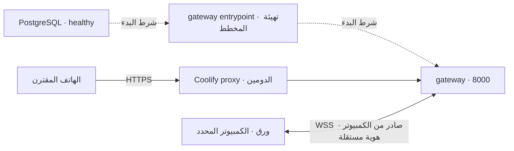

# ورق — Waraq Studio

مستودع واحد لبرنامج Windows الذي ينفذ المهام، وبوابة إنترنت اختيارية على VPS للتحكم في نسخة محددة من البرنامج من الهاتف. تبقى المعالجة والنتائج ومفاتيح الخدمات في الكمبيوتر.

| أريد… | المسار المناسب |
|---|---|
| تشغيل ورق على Windows | [الإصدارات](https://github.com/M-Jadallah/WaraqStudio/releases) ثم تنزيل المثبّت أو ZIP المحمول؛ [دليل التطبيق](README_AR.md) |
| نشر بوابة هاتفي على Coolify | [الإعداد المخصص للدومين](deploy/relay/COOLIFY_SETUP_AR.md)، باستخدام `compose.relay.yaml` من هذا المستودع |
| مراجعة المصدر الذي بُني منه إصدار | مصدر الإصدار وبيانات الالتزام والبصمات المرفقة به؛ لا تعتمد فرع `main` المتغير لمراجعة إصدار قديم |
| تشغيل البوابة والنسخ الاحتياطي والتشخيص | [دليل تشغيل البوابة](deploy/relay/README_AR.md) |

## خريطة المستودع

```text
main.py                         نقطة تشغيل تطبيق Windows
waraq/                          محرك المهام والواجهة الأصلية وموصل الإنترنت
  qml/                          واجهة الديسكتوب
  mobile/                       واجهة الهاتف المشتركة بين LAN وبوابة الإنترنت
relay/                          خادم البوابة، الهويات، الاقتران وتوجيه الأجهزة
deploy/relay/                   Dockerfile ومدخل التشغيل وأدلة Coolify
compose.relay.yaml              تعريف خدمات البوابة وقاعدة البيانات وتهيئتها
build_windows.py + installer.iss بناء الحزمة المحمولة ومثبّت Windows
.github/workflows/              اختبارات وبناء الإصدارات الآلي
tests/                          اختبارات المحرك وQt والمتصفح والعزل
```

واجهة الهاتف مشتركة عمدًا؛ بناء صورة البوابة ينسخ الملفات اللازمة لها فقط، ولا يشغّل Qt أو محرك المهام على VPS. يبقى `main.py` و`waraq/` في جذرهما حتى تظل مسارات التشغيل والبناء الحالية متوافقة.

## المسار الأول: Windows والإصدارات الآلية

ملف [Release](.github/workflows/release.yml) يعمل عند الدفع إلى `main`، أو دفع وسم `v*`، أو تشغيله يدويًا من GitHub Actions. يمر عبر الاختبارات، ثم يبني النسخة المحمولة والمثبّت، ويفحص تشغيل الحزمة وتثبيت البرنامج وإزالته قبل نشر الإصدار. شروط تشغيل هذه الأحداث موضحة في [توثيق GitHub Actions](https://docs.github.com/en/actions/reference/workflows-and-actions/events-that-trigger-workflows).

| مرفق الإصدار | الغرض |
|---|---|
| `WaraqStudio-<VERSION>-setup.exe` | مثبّت Windows |
| `WaraqStudio-<TAG>-windows-x64.zip` | نسخة محمولة، مع `_internal` |
| `WaraqStudio-<TAG>-source.zip` | المصدر الكامل من الالتزام الذي بُني منه الإصدار |
| `WaraqGateway-Coolify.zip` وملف `.zip.sha256` | مصدر البوابة الضروري للنشر عبر Coolify، مع بصمته |
| `WaraqStudio-<TAG>-provenance.json` | الالتزام الكامل ورابط مصدره وبصمات المرفقات |
| `SHA256SUMS` | بصمات ملفات التسليم للتحقق بعد التنزيل |

`TAG` يبدأ بـ`v`، و`VERSION` هو الرقم دونه. مصدر الإصدار مأخوذ بـ`git archive` من `GITHUB_SHA` المحدد في تشغيل Actions؛ تعديلات الجهاز المحلية أو تحديثات `main` اللاحقة لا تدخل في أرشيف ذلك الإصدار. استخدم قيمة `commit` ورابط الالتزام في ملف provenance للرجوع إلى المصدر نفسه، وراجع `SHA256SUMS` للتحقق من الملفات.

بعد تنزيل ZIP المحمول، فك المجلد كاملًا وشغّل `WaraqStudio.exe`؛ احتفظ بمجلد `_internal` معه. البوابة اختيارية: التشغيل المحلي وميزة Wi-Fi لا يحتاجان VPS. إعداد Deepgram وOpenCode ومهارات إنتاج Word موضح في [دليل Windows](README_AR.md).

## المسار الثاني: بوابة Coolify

الدومين الافتراضي في الإعداد هو **`https://waraqstudio.jadallah.work`**، ويمكن تغييره بمتغير `PUBLIC_BASE_URL`. ينشر Coolify البوابة من **مصدر Git** باستخدام `/compose.relay.yaml` وBase Directory `/`؛ لا يحتاج هذا المسار إلى إنشاء قاعدة بيانات مستقلة ثم كتابة رابط الاتصال يدويًا.



التعريف ينشئ **خدمتين فقط**: `postgres` و`gateway`؛ تهيئة المخطط خطوة داخل مدخل تشغيل `gateway` قبل Uvicorn. يربطهما بشبكة داخلية، ويشارك اعتماد قاعدة واحدًا، وينشئ التخزين الدائم وفحوص الصحة. يولّد Coolify قيمة `SERVICE_HEX_64_WARAQDB` ويحفظها للمورد؛ لا توجد كلمة مرور قاعدة عامة مضمنة في المستودع. راجع [دعم المتغيرات المولّدة في Coolify](https://coolify.io/docs/applications/builds/docker-compose#generated-stack-values).

إذا كنت ترقي موردًا قديمًا، عيّن المتغير الجديد **بقيمة كلمة مرور قاعدته الحالية قبل تحميل Compose الجديد**؛ لا تعِد توليد سر قاعدة قائمة. [تفاصيل الترقية](deploy/relay/README_AR.md#ترقية-مورد-قديم-له-قاعدة-موجودة).

يبقى إعداد المنصة للمرة الأولى بيد مالك الخادم: منح Coolify قراءة المستودع، واختيار الفرع، وتوجيه DNS، وربط دومين HTTPS بخدمة `gateway` ومنفذها الداخلي `8000`، وتفعيل حدث النشر التلقائي إن أردته. بعد ذلك يدير Compose ربط الخدمات عند كل نشر. يوضح [توثيق Coolify للنشر التلقائي](https://coolify.io/docs/applications/deployments/automatic-deployments) إعداد التكامل أو webhook؛ وجود ملف Compose وحده لا يضبط DNS أو يمنح صلاحيات Git.

إصدار GitHub وتنزيل Windows ونشر Coolify عمليتان مستقلتان. تفعيل النشر المباشر عند كل دفع في Coolify لا ينتظر نجاح GitHub Actions تلقائيًا؛ راجع نتائج اختبارات الالتزام قبل نشره، أو انشر الالتزام المقبول يدويًا. تتطلب البوابة عملية واحدة ونسخة واحدة في هذا الإصدار.

## دخول الهاتف وربط الأشخاص بأجهزتهم

1. ينشئ مشغّل البوابة من طرفية `gateway` رمزًا جديدًا لكل كمبيوتر:

   ```bash
   python -m relay enroll-code --minutes 10
   ```

2. يستلم صاحب الكمبيوتر الرمز بصورة خاصة، ويدخل في ورق **الإعدادات ← الوصول من الهاتف · الإنترنت**: الدومين، واسم جهازه، والرمز.
3. بعد الاتصال يضغط **ربط هاتف جديد** ويمسح QR بهاتفه، ويطابق اسم الجهاز والرقم ثم يوافق **من الكمبيوتر نفسه**.
4. يفتح الهاتف [واجهة ورق](https://waraqstudio.jadallah.work/internet) أو رابط الجهاز بعد الاقتران. لا يحتاج الشخص إلى حساب Coolify.

**كل كمبيوتر يقبل هاتفًا واحدًا فقط.** لتغيير الهاتف، ألغِ الحالي من ورق ثم أنشئ QR جديدًا. يمكن للهاتف نفسه الاقتران بعدة كمبيوترات بخطوات مستقلة، لكنه يختار الكمبيوتر المطلوب صراحة؛ صلاحية جهاز A لا تمنح صلاحية B. المتصفح الآخر يُعد جلسة أخرى. لا توجد حسابات مستخدمين مستقلة في هذه البوابة.

رمز التسجيل وQR وموافقة الكمبيوتر خطوات أمان مقصودة، وتبقى مطلوبة بعد إعداد النشر الآلي. يلزم إبقاء ورق مفتوحًا والكمبيوتر مستيقظًا وتفعيل اتصال الإنترنت بعد تشغيله. عند الانقطاع تُرفض أوامر الهاتف ولا تُخزن لتشغيلها لاحقًا؛ يستمر ما بدأ محليًا.

## التحقق قبل الاعتماد

تحتوي المسارات الآلية على اختبارات Windows وQt والمتصفح والعزل. يضيف [مسار البوابة على Ubuntu](.github/workflows/relay.yml) بناء Docker Compose وتشغيل PostgreSQL ويشترط [نشر Windows](.github/workflows/release.yml) نجاحه. لم يُشغّل Docker محليًا في بيئة التطوير الحالية؛ وجود الاختبار لا يعني أن آخر تشغيله نجح، فراجع نتيجة Actions للالتزام الذي تختاره. تبقى شهادة الدومين وإعدادات Coolify والاتصال من بيانات الجوال والنسخ الاحتياطي على VPS بحاجة إلى تحقق في بيئتك. تفاصيل القبول والاستعادة في [دليل البوابة](deploy/relay/README_AR.md).
