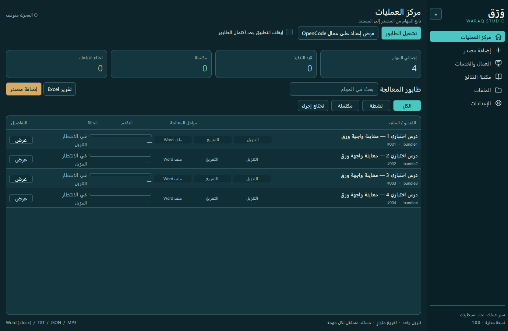
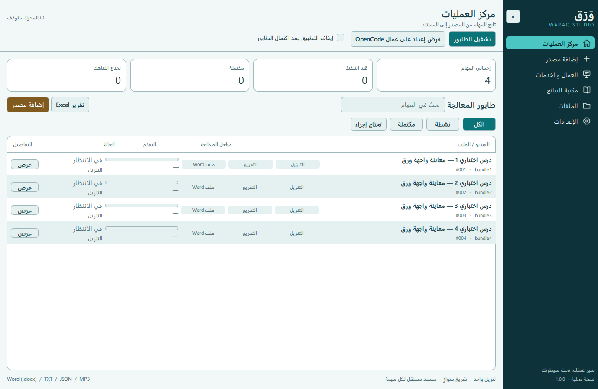

# إعادة تصميم ورق — الليل البترولي

## المرجع والحدود

- مرجع ما قبل التعديل: `a38688feeb23e2eaea35df1479e0af8caa5587b8`.
- المرجع البصري: `output/ui-concepts/concept-08.png`.
- التغيير محصور في QML وموارده واختبارات العرض وهذا التوثيق.
- لا تغيير في Bridge أو المجدول أو الخدمات أو التخزين أو المكتبة أو إعدادات المستخدم أو نقطة التشغيل والتغليف.
- بقيت الصفحات الست حية، وبقيت فهارسها `0..5` ومعرّفات الأتمتة القديمة.
- عقد ما قبل التعديل في `tests/fixtures/ui_contract.json`: بصمات ملفات التنفيذ، و67 تعبير استدعاء للخلفية، و29 دالة تحكم، ومعرّفات العناصر. اختبار العقد يكشف الحذف أو تغيير المعاملات أو أجسام الدوال المحمية.

## نظام العرض

`Theme.qml` يحدد الوضعين، والتباين، والألوان الدلالية، ومقاييس النص. المكونات تستقبل كائن الثيم نفسه؛ لا تحفظ إعدادات ولا تستدعي خدمات. الأيقونات SVG محلية أصلية، والخط Segoe UI الموجود في Windows.

الليل البترولي يستخدم الخلفية `#0C242A`، والبطاقات `#14363E`، والتركواز `#4BC6C3`، والذهبي `#D8AB64`. الفاتح مشتق منه بخلفية `#F2F7F7` وبطاقات بيضاء وتركواز `#0B7478`.

الصفحات تستخدم العرض المتاح بعد طرح القائمة والهوامش وتقسيمه على التكبير. مجموعات العمال تتوزع على ثلاثة أعمدة عند 1100 فأكثر، وعمودين عند 850 فأكثر، وعمود واحد دون ذلك. القوائم الداخلية والخارجية قابلة للتمرير للوصول إلى جميع العناصر. عرض القائمة 220/64، والتكبير 80–140% والكثافة يحترمان الإعدادات المحفوظة.

حدود نافذة Windows ونوافذ اختيار الملفات الأصلية بقيت أصلية. نافذة التفاصيل والنماذج الطويلة تستخدم محتوى قابلًا للتمرير مع إجراءات ثابتة في تذييل النافذة. لا يوجد متصفح عام للقرص، أو مؤشرات اتصال مصطنعة، أو نسب تقدم مقدرة، أو طلبات جديدة للصور المصغرة.

## مصفوفة الإجراءات

| العنصر | الحدث / الاستدعاء | شرط الإتاحة أو التأكيد |
|---|---|---|
| تشغيل الطابور | `runClicked → openForceDialog / toggleRunning` | سؤال الفرض يسبق البدء، وخيار تخطيه يخص الجلسة |
| الإيقاف بعد المهمة | `toggleRunning()` | يترك المنطق الخلفي ينهي الطلبات الحالية |
| الإغلاق التلقائي | `setAutoStop(checked)` | نفس خيار الجلسة؛ لا حفظ تلقائي جديد |
| فرض إعدادات | `setProviderOverride(provider, model, variant)` | نفس مسار الافتراضي/الفرض/الإلغاء |
| قراءة المصدر | `discover(urlField.text, forceRefresh.checked)` | زر القراءة معطل عند الانشغال أو فراغ الرابط |
| إلغاء القراءة | `cancelDiscovery()` | يظهر أثناء الانشغال |
| استيراد TXT/صوت | `importLocal(sourceFolderCombo.currentValue || "")` | نافذة Windows الأصلية، دون استيراد عند تبديل التبويب |
| النطاق/الكل/لا شيء | `selectRange(rangeField.text / "all" / "none")` | لا تغير في تحليل النطاق |
| تحديد فيديو | `selectSource(index, checked)` | يحترم توفر الفيديو |
| إعادة الترتيب | `moveSource(index, 1 / -1)` | الحدود نفسها لأول وآخر عنصر |
| إضافة للطابور | `enqueue(preset, template, folder)` | يعتمد على `hasSourceSelection`؛ يعود لمركز العمليات |
| مجلد جديد | `createFolder(folderName.text)` | نفس نافذة الإنشاء؛ تحديث اختيار المصدر بعد النجاح |
| نقل مهمة لمجلد | `assignJobFolder(selectedJob.id, currentValue || "")` | من تفاصيل المهمة |
| إعدادات العامل | `editWorker({id: row.id}, row.stage)` | لكل عامل مستقل، باستثناء عامل التنزيل |
| استقبال عامل | `setWorkerEnabled(row.id, checked)` | لا تبديل جماعي ولا تغيير للمعرف |
| إيقاف/استئناف خدمة | `pauseStage(row.stage, !row.paused)` | لا تغيير للفصل بين الإيقاف اليدوي والتلقائي |
| إعادة فحص | `recheckStage(row.stage) / resetWorker(row.id)` | يظهر عند وجود خطأ |
| مفتاح العامل | `saveKey(editingWorker.id, apiKey.text)` | بعد نجاح حفظ الإعدادات وبقاء النص غير فارغ؛ يُمسح بعد الإغلاق |
| إضافة/حفظ مزود | `saveProvider(raw)` | الخلفية تتحقق؛ الحقول تفرغ بعد النجاح فقط |
| حذف مزود | `deleteProvider(pendingProvider.id)` | تأكيد مستقل؛ المزود المدمج لا يعرض الحذف |
| إلغاء مهمة | `cancelJob(selectedJob.id)` | غير متاح للمهمة المكتملة |
| إعادة محاولة | `retry(id, current, false)` | نفس حالات الإتاحة وموعد الإعادة، وتحذير النتيجة غير المؤكدة |
| إعادة جماعية | `retryMany(ids, stage, status)` | نفس مجموعة البحث والتصفية والتأكيد والتحذير المدفوع |
| OpenCode بنسخة جديدة | `retry(id, "opencode", true)` | تفريغ موجود والمهمة ليست قيد التنفيذ |
| تفريغ بنسخة جديدة | `retry(id, "deepgram", true)` | صوت موجود والمهمة ليست قيد التنفيذ؛ تحذير تكلفة قبل التنفيذ |
| النتائج | `setResultsQuery(text) / setResultsFolder(currentValue)` | المجلد معرف ثابت؛ النتائج الوسيطة باقية |
| تصفية الملفات | `setFilesQuery / setFilesKind / setFilesFolder` | قيمة المجلد اسم المجموعة؛ لا تبديلها بمعرف النتائج |
| فتح/نسخ | `openPath(path) / copyText(path)` | أزرار المخرجات معطلة عند عدم توفر المسار |
| حذف ملف | `deleteLibraryFile(pendingFile.path)` | تأكيد؛ حذف نسخة المكتبة فقط |
| التنظيم/التحديث | `organizeLibrary() / refreshLibrary()` | يحترمان `libraryBusy`؛ لا قراءة دورية إضافية |
| التصدير | `exportWord() / exportReport()` | نفس اختيار وجهة الحفظ ومسارات التنفيذ |
| حفظ الإعدادات | `saveSettings(JSON.stringify(settings))` | بقي الحفظ اليدوي؛ الثيم والتكبير والكثافة والطي تحفظ كما سابقًا |
| القوالب وJSON | نفس دوال التحرير والتحقق والحفظ | لا تغيير المتغيرات المطلوبة أو لقطة المهمة |
| تحديث YouTube | `updateYoutube()` | معطل أثناء التحديث؛ لا تحديث تلقائي جديد |
| إغلاق التطبيق | `prepareClose()` | بقي مسار الإغلاق الآمن |

## التحقق

1. `python -m pytest -q` يغطي المحرك والنماذج والكتالوج وعقد إعادة التصميم وتباين ألوان النص.
2. `python tests/verify_ui.py output/ui-redesign/after` يغطي التفاعلات الأصلية والتأكيدات والنماذج والتمرير.
3. `python tests/verify_redesign.py output/ui-redesign/matrix` يغطي 432 تكوين صفحة و48 تكوين نافذة، مع حفظ الصور ورسائل QML. يزيل إطار النافذة داخل بيئة الاختبار فقط حتى يمكن التقاط مساحة 1920×1080 كاملة على شاشة 1080p؛ التطبيق المنتج يحتفظ بإطاره الأصلي.
4. `python build_windows.py` يبني حزمة Windows بالآلية الحالية التي تجمع مجلد QML وموارده.
5. تشغيل الملف التنفيذي باستخدام `--data-dir` مؤقت و`--smoke` و`--screenshot`؛ دون استخدام قاعدة المستخدم أو تشغيل الطابور.

تستخدم الاختبارات قاعدة ومكتبة مؤقتتين، ومفاتيح بديلة، وكتالوجات نماذج محلية. لا تتصل بخدمات YouTube أو Deepgram أو OpenCode.

استُخدم Headroom لحصر الملفات ومراجعة الفرق البنيوي، وSerena لقراءة وصف المشروع وعقد Python، وCodeGraphContext لتحديد اعتماديات Bridge. فهرس الرسم ليس مصدرًا لاستدعاءات QML الديناميكية ولا دليلًا على غيابها.

## الرجوع والنشر

الرجوع يكون بإعادة ملفات الواجهة ومواردها إلى المرجع أعلاه، وإعادة بناء الحزمة. لا توجد ترحيلات بيانات تُعكس. لا يتضمن العمل دفعًا إلى main أو وسومًا أو نشر إصدار؛ إعدادات الإصدار الحالية تنشر تلقائيًا عند ذلك.

صور المرجع الأصلي والجديد ومعرض المقارنة ونتائج التحقق محفوظة تحت `output/ui-redesign`، دون استبدال التصورات العشرة.

## نتيجة القبول — 2026-10-20

- نجح 96 اختبارًا آليًا، بما فيها فحوص ثبات ملفات التنفيذ والعقد والألوان.
- نجح الفحص التفاعلي الأصلي بكل سيناريوهاته؛ لم يُحذف أي سيناريو قديم.
- نجحت 432 حالة للصفحات و48 حالة للنوافذ بعد آخر تعديلات العرض. سجل رسائل QML النهائي فارغ.
- اختُبرت المسودات والتحديد والتركيز والتمرير، وكذلك تغيير الثيم أثناء بقاء نموذج العامل مفتوحًا.
- جرى بناء الملف التنفيذي بالآلية الحالية. تقارن أداة فحص الحزمة بصمات موارد QML والأيقونات وعددها 31 مع المصدر قبل تشغيله.
- فُحصت الصفحات الست في الوضعين من الملف التنفيذي نفسه، إضافة إلى فحص البيئة والتشغيل الأولي، باستخدام بيانات مؤقتة ومعرّفات اعتماد عشوائية لا تطابق عمال المستخدم.
- لم تتغير ملفات Python الخلفية، ولم تُستخدم قاعدة المستخدم أو مفاتيحه، ولم تُرسل مهام إلى الخدمات الخارجية.
